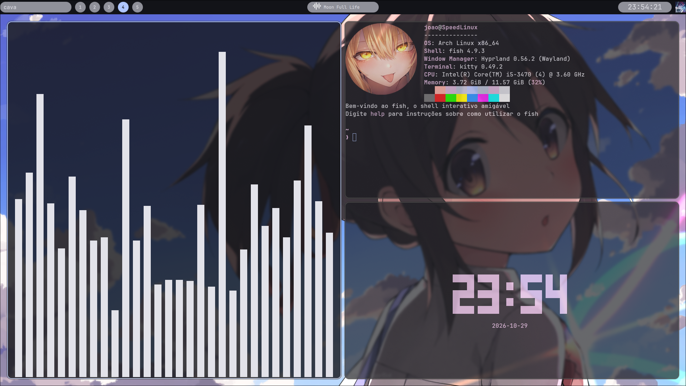

<h1 align="center">MELLOW DOTS<h1/>

> Note: Mellow Dots is still a work in progress. Contributions are always welcome (;


<h1 align="center">Screenshots<h1/>



[Video Preview](https://www.youtube.com/watch?v=ZvcxJIYnx7c)


<h1 align="center">Dependencies<h1/>

- Font: JetBrainsMono
- Zenity
- Kitty
- Hyprland && Hyprpaper
- Quickshell
- Fish and Starship

<h1 align="center">Installation<h1/>

```bash
git clone https://github.com/speedxzpdev/mellow-dots.git
cd mellow-dots
sh scripts/install.sh
```

```
hyprctl reload
```

> Notes: Some dependencies such as hyprland, quickshell and kitty may need to be installer separately if they are not handled by installer.

<h1 align="center">Keybinds<h1/>

---

| Keybind | Action |
| --- | --- |
| `Super + 1-9` | `Switch between workspaces` |
| `Super + scroll` | `Does the same thing` |
| `Super + q` | `Open kitty` |
| `Super + b` | `Open Firefox` |
| `Super + s` | `Open spotify (Require Spotify)` |
| `Super + SHIFT + s` | `Print (Require Grim)` |
| `Super + f` | `Open dolphin` |
| `Super + c` | `Close Window` |

---

Inspirations: [Caelestia-dots](https://github.com/caelestia-dots/caelestia), [End-4](https://github.com/end-4/dots-hyprland)